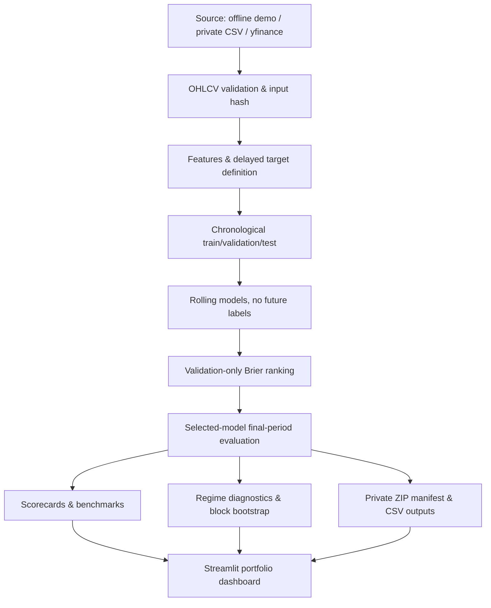

# Architecture — QuantMind 1.0

## Modules

- `src/quantmind/core.py`: original v0.3 features, two classic models, historical fold evaluator, metrics.
- `src/quantmind/audit.py`: OHLCV validation, canonical CSV bytes, input hashes, original v0.3 audit.
- `src/quantmind/diagnostics.py`: original baseline, fee and reliability diagnostic routines.
- `src/quantmind/v1.py`: chronological protocol, rolling refits, model choice, backtest, uncertainty, artifact manifest.
- `app.py`: new 1.0 Streamlit dashboard including multi-symbol view and study drilldown.
- `pages/`: backward-compatible legacy research tools.
- `scripts/run_v1_research.py`: non-interactive offline study reproducibility.
- `scripts/log_paper_forecast.py`: UTC timestamped JSONL paper predictions (does not prove that imported data were truly live).
- `service_api.py`: optional FastAPI `/health`, `/v1/demo/study` routes (bounded synthetic study, read-only).

## Security and access

The default deployment does **not** accept brokerage login, transfer money, initiate orders, or connect to accounts. `service_api` only executes bounded synthetic research (no arbitrary URLs, file paths, shell commands or trading). The Streamlit app may contact public data provider when a user explicitly chooses Yahoo Finance, and may import CSV into server memory to run the study. **Do not deploy private snapshots on a shared/public server without an appropriate security review.**

The API runs on `127.0.0.1` by default. If publicly exposed, add rate limiting, authentication where appropriate, request timeouts and security monitoring. Provider price data are deliberately excluded from the public repository. The dashboard's current session data are held in Streamlit session state and are not intended as a multi-user production database.

## Why Streamlit first?

Research needs fast, transparent controls and deep charts, and the core code is already modular. FastAPI is separately available for the bounded demo endpoint. A future React/TypeScript rewrite would be justified only when the project truly needs complex multi-user workflows; portfolio completeness does not require adding microservices just to signal complexity.
